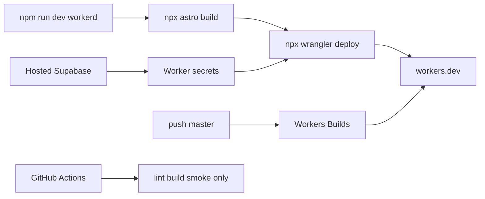

# First deployment to Cloudflare Workers

The platform is already decided in [context/foundation/infrastructure.md](context/foundation/infrastructure.md): **Cloudflare Workers**, not Pages. [context/foundation/tech-stack.md](context/foundation/tech-stack.md) still says `cloudflare-pages` and GitHub Actions auto-deploy; that starter hint is history. This deploy does not rewrite that file.

The app is Astro 7 SSR (`output: "server"`, `@astrojs/cloudflare` in [astro.config.mjs](astro.config.mjs)) with a Worker config already in [wrangler.jsonc](wrangler.jsonc). Auth talks to external Supabase through `SUPABASE_URL` and `SUPABASE_KEY` ([src/lib/supabase.ts](src/lib/supabase.ts)). The git branch that CI and `origin` use is `master`, not `main`. Remote: `https://github.com/Ajoni/10xdev.git`.

This file is the deployment record. Do not commit unless asked. Do not print secret values into this file or the chat.




## Prerequisites

These stop the agent until you do them. Phases start only after the boxes below are checked.

- [x] A Cloudflare account on the free Workers plan. Billing changes (Workers Paid, $5/month) only if verification shows steady Error 1102.
- [x] CLI auth, once: Node 22 (`.nvmrc`), dependencies via `npm ci`, then `npx wrangler login` in a browser. Wrangler stays the repo devDependency (`npx wrangler`, locked today at 4.131.1). Do not install a global Wrangler and do not use `cf`. Alternative: a `CLOUDFLARE_API_TOKEN` in the shell only, scoped to this Worker (scripts edit plus secrets for this script). No DNS, no billing, no unrelated Workers. Confirm with `npx wrangler whoami`. If the first deploy asks to accept the `workers.dev` subdomain terms, that answer is yours.
- [x] A hosted Supabase project. Local `supabase start` is not reachable from the Worker. This app uses Supabase Auth only. [src/lib/supabase.ts](src/lib/supabase.ts) builds a cookie session with `createServerClient`. There is no `supabase/migrations` directory and no app tables. Do not run `supabase db push`, `supabase link`, or `supabase config push`. [supabase/config.toml](supabase/config.toml) configures the Docker stack on your machine. Hosted Auth ignores it. That file sets `site_url` to `http://127.0.0.1:3000` and `enable_confirmations` to `false`. Pushing it would point the hosted project at localhost. Change the hosted project in the Supabase dashboard. No `supabase/config.toml` edit for production. Keep local `site_url` as it is. Opened the existing project **Ajoni's Project** (`gbtjffwwpbwhswpiimze`, `eu-west-1`, `ACTIVE_HEALTHY`). It is not linked. `config.toml` was not pushed.
- [x] Keys chosen, ready to type in Phase 3. Create or open a hosted project. In **Project Settings → API Keys** (the Connect dialog shows the same URL and publishable key; there is no separate Settings → API page):
  - `SUPABASE_URL`: `https://gbtjffwwpbwhswpiimze.supabase.co`.
  - `SUPABASE_KEY`: the **publishable** key named `default` (`sb_publishable_...`). A legacy `anon` JWT also exists on this project; do not use it. `anon` and `service_role` are deprecated by the end of 2026. The key value stays in the Supabase dashboard until Phase 3.
  - Leave the secret key (`sb_secret_...`) and the legacy `service_role` JWT off the Worker. Those bypass row-level security. This client only signs users in and reads `auth.getUser()`.
  - Local and hosted keys are different. `npx supabase status` prints keys for `http://127.0.0.1:54321`. Those belong in `.env` and `.dev.vars` for `npm run dev`. Putting `127.0.0.1` into the Worker secret makes every production auth call fail, because Cloudflare cannot reach your machine. `.dev.vars` stays local and gitignored. GitHub Actions build secrets do not become Worker runtime secrets.

## Phase 1 — Config before any deploy

- [x] In [astro.config.mjs](astro.config.mjs), set `session: false` so the first deploy does not create a `SESSION` KV namespace. Login stays on Supabase cookies.
- [x] Pass `imageService: "compile"` to `cloudflare()`. Nothing in `src/` uses `astro:assets`, so the default `cloudflare-binding` would attach an Images binding this app does not use.
- [x] In [wrangler.jsonc](wrangler.jsonc), rename `name` from `10x-astro-starter` to `work-slop` before the Worker exists. Workers Builds later refuses to deploy if the dashboard name and this field differ.
- [x] Leave [.github/workflows/ci.yml](.github/workflows/ci.yml) as lint, typecheck, build, and local smoke. Do not add a deploy job. Do not run `wrangler pages deploy`, `wrangler dev`, or the preview `cf` CLI.

## Phase 2 — Local workerd check

- [x] Local check, before Cloudflare: `npm run dev` (this is already workerd), then `npm run build` and `npm run preview`.

## Phase 3 — First deploy, secrets, and dashboard checks

First production deploy of the **default** environment (no `CLOUDFLARE_ENV`):

```bash
npx astro build && npx wrangler deploy
```

Use the **Workers & Pages** list (some nav trees put it under **Compute**). Do not create a Pages project, and do not use **Import a repository** after `wrangler deploy` has already created `work-slop`. Importing would create a second Worker.

The dashboard name and the `name` field in [wrangler.jsonc](wrangler.jsonc) must both be `work-slop`. Compatibility date `2026-05-08` and `nodejs_compat` stay in that file. Do not override them in the dashboard, or the next git deploy will fight the click-changes.

- [x] Deploy with `npx astro build && npx wrangler deploy`.
- [x] The URL Wrangler prints responds on `/` and `/auth/signin`. Before secrets, the home page shows the existing “Supabase is not configured” state.
- [x] Set the two secrets, typed by you, either with `npx wrangler secret put` or under **Workers & Pages → work-slop → Settings → Variables and Secrets → Add.** After secrets, that state is gone.
  - Type: **Secret** (not plaintext text).
  - First variable name: `SUPABASE_URL`. Value: `https://gbtjffwwpbwhswpiimze.supabase.co` from the hosted project.
  - Add another: `SUPABASE_KEY`. Value: the publishable key (`sb_publishable_...`) or the legacy anon JWT. Never the secret key or `service_role`.
  - Select **Deploy**. That publishes a new version immediately, same as `wrangler secret put`. The value is hidden afterward and cannot be read back.
  - Do not put these in **Settings → Builds → Build variables and secrets**. Those exist only while `npx astro build` runs. They are not available when a user hits the Worker. Do not use account-level Secrets Store (still beta as of the July 2026 secrets docs). Do not add a `vars` block to `wrangler.jsonc`.
- [x] Sign up or sign in, open `/dashboard`, and watch `npx wrangler tail`. Supabase wait time does not count as CPU. If `exceededCpu` / Error 1102 is steady on that signed-in page, stop and ask you before any paid upgrade. Skipped on request. Unsigned tail showed no Error 1102: `GET /` 200 at 20 ms CPU, `GET /dashboard` 302 at 7 ms CPU, `GET /auth/signin` 200 at 25 ms CPU. Outcomes were `ok`.
- [x] A bad Worker version is `npx wrangler versions list`, then `npx wrangler rollback <version-id>`. That does not roll back Supabase SQL. Do not roll back a healthy first deploy just to rehearse. Active version after the secret updates: `c88d2657-b828-483a-876e-695a96719415`. Not rolled back.

### Domains

**Workers & Pages → work-slop → Settings → Domains & Routes.**

- [x] Leave the `workers.dev` route enabled. First deploy has no custom domain and no zone route. Trigger: `https://work-slop.adam-sienkiewicz9765.workers.dev`.
- [x] If the first `wrangler deploy` asks you to accept the `workers.dev` subdomain terms, accept that in the browser. The agent cannot click it. Deploy did not prompt.

### Bindings to confirm after deploy

**Workers & Pages → work-slop → Settings → Bindings.**

- [x] No `SESSION` KV namespace. If one appears, `session: false` did not ship. Deploy bindings: `env.ASSETS` only.
- [x] No Images binding. If one appears, `imageService: "compile"` did not ship.
- [x] No R2, D1, Queues, or Durable Objects.

### Logs and the CPU cap

**Workers & Pages → work-slop → Observability** (or Logs). `observability.enabled` is already true in `wrangler.jsonc`, so this tab should show invocations without an extra dashboard toggle.

- [x] **Settings → CPU time limit** stays at the free-plan default of 10 ms. That cap cannot be raised on the free plan. Open this setting only if `wrangler tail` or the invocation status **Exceeded CPU Time Limits** shows steady Error 1102. Raising it means Workers Paid at $5/month, and that click is yours. Not raised. No Error 1102 on the unsigned requests above.

## Phase 4 — Hosted Auth after the hostname exists

Set these after the first `wrangler deploy` prints the real hostname.

- [x] **Authentication → URL Configuration:**
  - Site URL: `https://work-slop.adam-sienkiewicz9765.workers.dev` (no path). Set in the dashboard.
  - Redirect URLs: `https://work-slop.adam-sienkiewicz9765.workers.dev/**`. Set in the dashboard.
  - Signup calls `signUp({ email, password })` with no `emailRedirectTo`, then sends the browser to `/auth/confirm-email`. Confirmation mail therefore uses the Site URL above.
- [x] **Authentication → Providers → Email** (the starter README labels this **Authentication → Email**). Hosted projects start with confirmation required. Local `enable_confirmations = false` does not change that. Turn **Confirm email** off so a new user can sign in without an inbox. That matches the PRD, which skips email confirmation, and it matches what `npm run smoke` expects. Turned off in the dashboard.
- [x] On the deployed Worker, [src/pages/auth/confirm-email.astro](src/pages/auth/confirm-email.astro) still shows “Check your email”, because `import.meta.env.DEV` is false in production. With confirmation off, that page is informational. The link text is **Back to sign in**.
- [x] Leave email/password as the only provider. Do not enable OAuth, magic links, anonymous sign-in, or phone.
- [x] No schema, RLS policies, or seed. Auth uses Supabase’s built-in `auth.users`. No custom SMTP. With confirmation off, the hosted project does not need to send mail for the first signup test.

## Phase 5 — Workers Builds

Do this only after the manual deploy works, Wrangler in [package.json](package.json) is **>= 4.135.0**, and the config mitigations are on `origin/master`. A Builds run deploys whatever is on the remote branch and can overwrite the good manual deploy.

**Workers & Pages → work-slop → Settings → Builds → Connect.**

Connect Builds on the Worker that already exists.

- [x] Bump Wrangler to >= 4.135.0. Locked at 4.147.0 in `package-lock.json` (`package.json` range `^4.131.1`).
- [x] Push the config mitigations to `master` before the first Builds run. That commit stays yours to request. Pushed `69115b0..72191af` to `origin/master`. `72191af` includes `session: false`, `imageService: "compile"`, and Worker name `work-slop`.
- [x] Git account: the GitHub account that owns `Ajoni/10xdev`.
- [x] Repository: `Ajoni/10xdev`.
- [x] Production branch: `master`. The form defaults to `main`. Leave it on `main` and pushes to this repo will not deploy.
- [x] Root directory: repository root (empty).
- [x] Build command: `npx astro build`
- [x] Deploy command: `npx wrangler deploy` (the default). Workers Builds uses the Wrangler version in `package.json`, not a global install.
- [x] Preview command: leave the default `npx wrangler preview` only after the Wrangler bump. Until then, leave non-production preview builds off. If the form has no off switch, do not push other branches. Preview builds left off.
- [x] API token: keep the token Cloudflare generates for Builds. It is a user token with Workers Scripts (edit), Workers KV (edit), Workers R2 (edit), Workers Routes (edit) on zones, plus account and user read. Do not replace it with a token that can change billing. Custom tokens live under **My Profile → API Tokens**.
- [x] Build variables: none.

Non-production branches, once preview builds are on, get a Preview URL from the **Previews** section and can comment on same-repo pull requests. Previews do not inherit production secrets. Add preview secrets only under that Preview’s own settings, and do not put real user data there. Fork pull requests do not get production secrets.

A production-branch build shows under **Deployments** and, when the deploy command is `npx wrangler deploy`, becomes the active deployment. To build without promoting, the deploy command would be `npx wrangler versions upload`. This project keeps `npx wrangler deploy`.

## Recorded result

After a successful deploy, append to this file:

- `workers.dev` URL: `https://work-slop.adam-sienkiewicz9765.workers.dev`
- Worker name `work-slop`
- Secret names only (`SUPABASE_URL`, `SUPABASE_KEY`)
- Builds is connected on `work-slop`. Production branch `master`. Preview builds off. The push of `72191af` happened before Connect, so that commit did not start a build.

